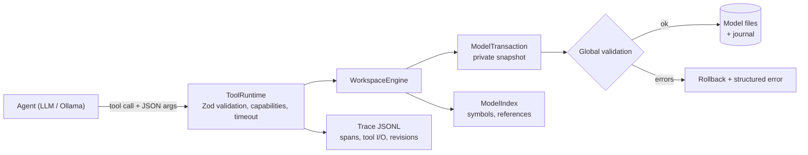
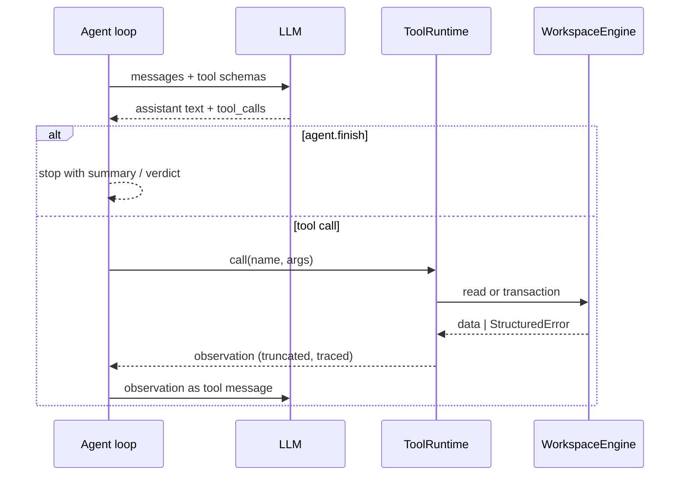
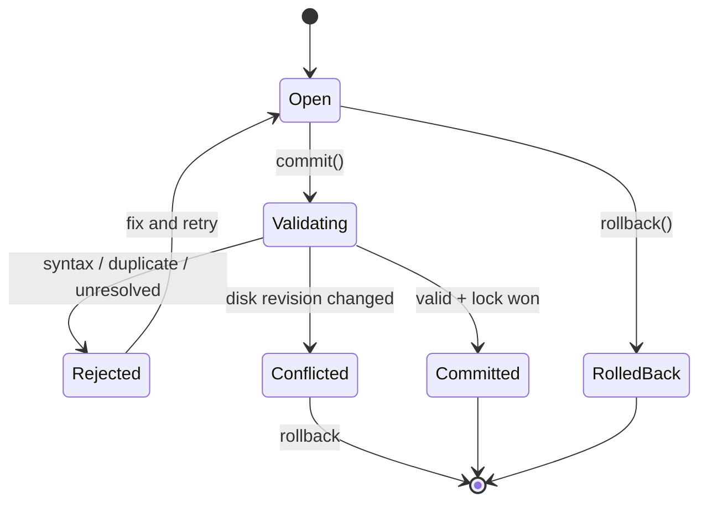
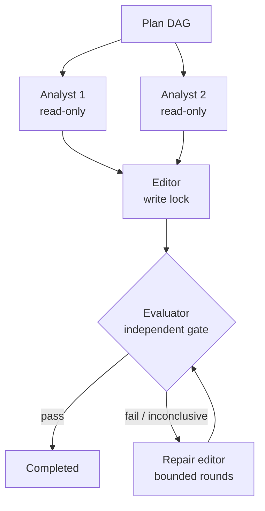
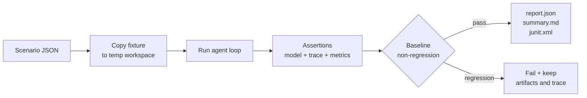
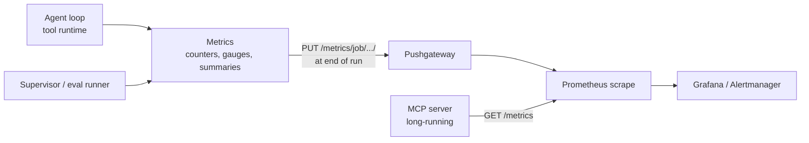

# sysml-ai

Agentic loops to **edit, analyse and evaluate** SysML v2 / KerML models.
The engine stays deterministic; agents act only through a typed tool catalog.

## Architecture



- **Engine/agent boundary**: no direct file access. Tools are the only entry points.
- **Typed contracts**: Zod inputs/outputs, JSON Schema for LLMs and MCP.
- **Transactions**: private model snapshot, full validation, optimistic revision check, atomic write, rollback.
- **Structured errors**: `code`, `category`, `retryable`, `details`, `location`, `suggestions`.
- **Observability**: JSONL traces (spans + events), Prometheus metrics, transaction journal, evaluation reports.

### Agentic loop



### Transaction



### Multi-agent supervision



## Getting started

```bash
npm install
npm test              # 41 tests: engine, tools, agent, orchestration, evaluation, metrics
npm run tools         # tool catalog visible to a role
```

Node 24+ runs the TypeScript sources directly.

### Local agent (Ollama)

```bash
ollama serve
ollama pull qwen2.5-coder:7b
npm run doctor

node src/cli.ts agent \
  --dir ../sysml-vscode/examples/demo \
  --role editor \
  --goal "Rename Vehicle to VehiclePlatform and update all references"
```

Environment: `OLLAMA_HOST`, `OLLAMA_MODEL`. The model must support tool calling.

### Evaluation

```bash
npm run eval                         # deterministic scripted scenarios
npm run eval -- --update-baseline    # record the non-regression baseline
npm run eval -- --provider ollama --model qwen2.5-coder:7b
```

Each scenario (`eval/scenarios/*.json`) defines a fixture, a goal, a budget and assertions:
status, verdict, model validity, present/absent elements, required tools, steps, errors, tokens, summary.
Reports go to `eval/reports/<run>/`: `report.json`, `summary.md`, `junit.xml`, JSONL traces,
plus a copy of the workspace on failure.



### Multi-agent supervision

```bash
node src/cli.ts supervise --dir ./models --plan plan.json --provider ollama
```

The supervisor runs a DAG: reads in parallel, writes serialised by file locks,
retries with backoff, per-task timeout, cooperative cancellation, resumable checkpoints and an evaluator gate.

```json
{
  "id": "feature-brake",
  "tasks": [
    { "id": "analyse", "role": "analyst", "goal": "Inspect braking requirements" },
    { "id": "edit", "role": "editor", "goal": "Add BrakeSystem", "dependsOn": ["analyse"], "targetFiles": ["vehicle.sysml"] },
    { "id": "eval", "role": "evaluator", "goal": "Verify the model", "dependsOn": ["edit"], "requireVerdict": "pass" }
  ]
}
```

### MCP

The same catalog is exposed over MCP (stdio), without duplicating business logic:

```json
{
  "mcpServers": {
    "sysml-ai": {
      "command": "node",
      "args": ["/home/john-doe/sysml-ai/src/cli.ts", "mcp", "--dir", "/path/to/model"]
    }
  }
}
```

Tool names such as `model.list_elements` become `model__list_elements` over MCP.

## Tools

| Group | Tools |
|---|---|
| Read | `model.list_files`, `model.list_elements`, `model.get_element`, `model.get_source`, `model.validate`, `model.find_references` |
| Edit | `model.create_element`, `model.create_file`, `model.rename_element`, `model.delete_element`, `model.edit` |
| Analysis | `analysis.summary`, `analysis.requirements`, `analysis.traceability`, `analysis.impact` |

Role capabilities: analyst `read+analyze`, editor `read+write+analyze`, evaluator `read+analyze`.
The runtime rejects any tool outside the granted capabilities before execution.

## Evaluation and non-regression

Metrics: success rate, steps, tool calls, tool error rate, p50/p95 duration, tokens.
The baseline (`eval/baseline.json`) rejects a drop in success and an increase in steps, calls,
duration or tokens beyond configurable tolerances.

## Prometheus metrics

Agents and evaluation runs are short-lived, so they **push** to a Prometheus Pushgateway instead of exposing an endpoint. The long-running MCP server keeps a scrape endpoint.



```bash
node src/cli.ts agent ... --pushgateway http://127.0.0.1:9091
node src/cli.ts eval ... --pushgateway http://127.0.0.1:9091
node src/cli.ts supervise ... --pushgateway http://127.0.0.1:9091
```

`PUSHGATEWAY_URL` sets the default. Grouping labels are `job=sysml-ai-<command>`, `instance=<hostname>` and `component=<command>`; override with `--push-job` and `--push-instance`. Each run uses `PUT`, so the previous run is replaced rather than accumulating stale counters.

The MCP server is persistent and exposes `/metrics` (`--metrics-port 0` picks a free port). `/health` returns `ok`.

```bash
node src/cli.ts mcp --dir ./models --metrics-port 9464
curl -s http://127.0.0.1:9464/metrics
```

Scrape the Pushgateway and the MCP endpoint:

```yaml
scrape_configs:
  - job_name: pushgateway
    honor_labels: true
    static_configs:
      - targets: ["127.0.0.1:9091"]
  - job_name: sysml-ai-mcp
    static_configs:
      - targets: ["127.0.0.1:9464"]
```

Exported families include:

- `sysml_ai_agent_runs_total{role,status}`
- `sysml_ai_agent_duration_ms{quantile,role}` with `_sum` and `_count`
- `sysml_ai_llm_calls_total{provider,status}`
- `sysml_ai_tool_calls_total{tool,status}`
- `sysml_ai_tool_duration_ms{quantile,tool}`
- `sysml_ai_supervisor_runs_total{plan,status}`
- `sysml_ai_scenario_total{scenario,status}`
- `sysml_ai_scenario_duration_ms{quantile,scenario}`

If the Pushgateway is unreachable, the run still succeeds and a warning is written to stderr. Model edits are never rolled back because of observability.

## Licence

GPL-3.0-or-later. See [LICENSE](LICENSE).
The ANTLR4 SysML v2 parser is reused from `sysml-vscode` (same licence).
